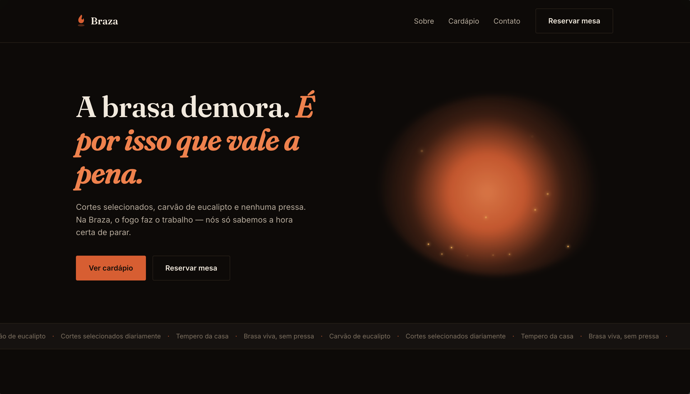

# 🔥 Braza

Site de uma churrascaria fictícia, feito do zero com **HTML, CSS e JavaScript puros**: sem frameworks, sem dependências e sem etapa de build.



> ⚠️ **Projeto demonstrativo.** Endereço, telefone, Instagram e preços são inventados, e o formulário de reserva **não envia nada** (ele só valida os campos e mostra uma confirmação na tela). As fotos do cardápio são ilustrativas.

## Sobre o projeto

A Braza é um conceito de churrascaria de cortes nobres na brasa. A identidade visual gira em torno de preto carvão e laranja brasa, com tipografia serifada (Fraunces) para os títulos e Inter para o texto. O site tem hero, seção "sobre", cardápio com fotos e contato com reservas e mapa.

## Funcionalidades

- **Cardápio em abas** (Carnes Nobres, Acompanhamentos, Bebidas e Sobremesas), com transição direcional: a lista atual sai para um lado e a nova entra pelo lado oposto, conforme a posição da aba escolhida
- **Foto ampliada em modal**, usando o elemento nativo `<dialog>`: abre por mouse, toque ou teclado, fecha com `Esc` ou clicando fora da foto, e devolve o foco ao botão que a abriu
- **Menu mobile animado**, com abertura e fechamento suaves
- **Link ativo na navegação**, destacado conforme a seção visível (`IntersectionObserver`)
- **Revelação suave ao rolar a página**
- **Formulário de reserva com validação** de nome, telefone (com DDD) e número de pessoas
- **Layout responsivo** (CSS Grid e Flexbox)
- **Acessibilidade:** link "pular para o conteúdo", `aria-label` nos botões de ícone, foco visível e respeito a `prefers-reduced-motion` (quem desativa animações no sistema recebe as trocas instantâneas)

## Tecnologias

- HTML5 semântico
- CSS3 com variáveis (custom properties), Grid, Flexbox, `@keyframes` e `@starting-style`
- JavaScript (ES6+) em um único módulo, com `const`/`let` e `"use strict"`
- Google Fonts (Fraunces e Inter) e embed do Google Maps

## Estrutura

```
.
├── index.html
├── styles.css
├── script.js
├── close-SVG.svg
└── Imagens/
    ├── Carnes nobres/
    ├── Acompanhamentos/
    ├── Bebidas/
    └── Sobremesas/
```

## Como rodar localmente

Não precisa instalar nada:

```bash
git clone https://github.com/Magoozim/Braza.git
cd Braza
```

Abra o `index.html` no navegador. Se preferir um servidor local, a extensão **Live Server** do VS Code funciona bem.

> O mapa e as fontes dependem de internet. A animação de entrada do modal usa `@starting-style`: em navegadores antigos ele abre normalmente, só sem animação.

## Autor

Feito por **Magoozim**.
